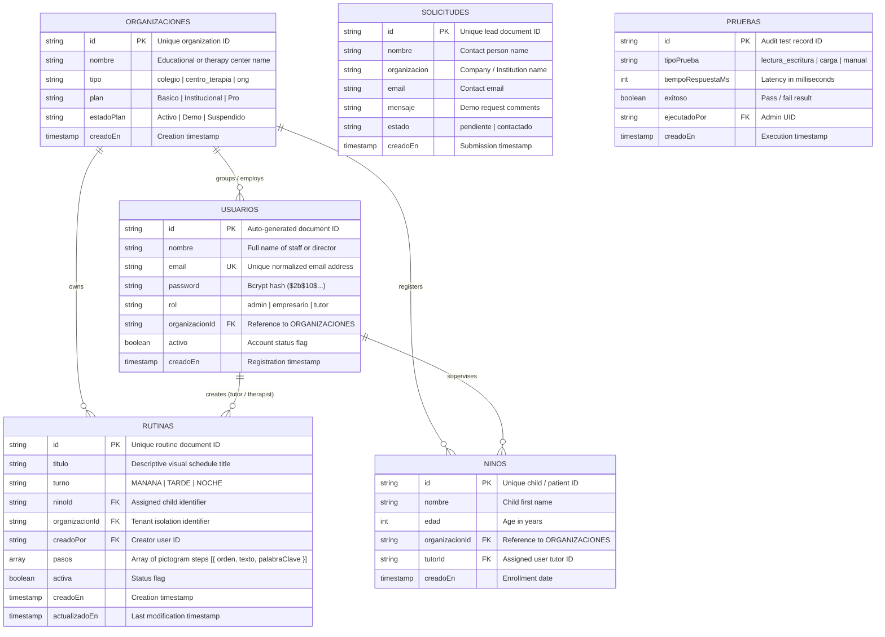

# INSTITUTO TECNOLÓGICO SUPERIOR TECSUP
## Software Design and Development

# U-PAD PROJECT — 25% MILESTONE TECHNICAL DOCUMENTATION
**Web Management and Visual Agendas Platform for Individuals with Autism Spectrum Disorder (ASD)**

---

**Teacher:**
- Calvo Guzmán, Victor Alejandro

**Presented by:**
- Team U-Pad Development Group

**Location & Date:**  
Arequipa – Perú  
2026 – I

---

# TABLE OF CONTENTS

- [CHAPTER 1: 25% MILESTONE SYSTEM ARCHITECTURE AND CORE IMPLEMENTATION](#chapter-1-25-milestone-system-architecture-and-core-implementation)
  - [1. Project Description](#1-project-description)
    - [1.1 Project Objective](#11-project-objective)
    - [1.2 Technology Stack](#12-technology-stack)
      - [1.2.1 Database](#121-database)
      - [1.2.2 Backend](#122-backend)
      - [1.2.3 Frontend](#123-frontend)
      - [1.2.4 Testing](#124-testing)
      - [1.2.5 Security, Obfuscation and Documentation](#125-security-obfuscation-and-documentation)
  - [2. Database Design](#2-database-design)
    - [2.1 Entity-Relationship Diagram](#21-entity-relationship-diagram)
    - [2.2 Description of Collections and Relationships](#22-description-of-collections-and-relationships)
      - [2.2.1 Collection: ORGANIZACIONES](#221-collection-organizaciones)
      - [2.2.2 Collection: USUARIOS](#222-collection-usuarios)
      - [2.2.3 Collection: NINOS](#223-collection-ninos)
      - [2.2.4 Collection: RUTINAS (Primary Business Entity)](#224-collection-rutinas-primary-business-entity)
      - [2.2.5 Collection: SOLICITUDES](#225-collection-solicitudes)
      - [2.2.6 Collection: PRUEBAS](#226-collection-pruebas)
    - [2.3 Cloud Database Connection (Google Cloud Firestore + Emulator)](#23-cloud-database-connection-google-cloud-firestore--emulator)
    - [2.4 Environment Variables for Database (.env.example)](#24-environment-variables-for-database-envexample)
  - [3. Environment Setup](#3-environment-setup)
    - [3.1 Cloud Environment Readiness](#31-cloud-environment-readiness)
    - [3.2 Environment Variables (.env) – Structure and Usage](#32-environment-variables-env--structure-and-usage)
    - [3.3 Project Structure](#33-project-structure)
  - [4. Authentication and Security](#4-authentication-and-security)
    - [4.1 User Registration Flow](#41-user-registration-flow)
    - [4.2 User Login Flow](#42-user-login-flow)
    - [4.3 Password Hashing (bcrypt Security Implementation)](#43-password-hashing-bcrypt-security-implementation)
    - [4.4 Stateless Token Architecture (JWT with HMAC-SHA256)](#44-stateless-token-architecture-jwt-with-hmac-sha256)
  - [5. Endpoint Development and Initial CRUD](#5-endpoint-development-and-initial-crud)
    - [5.1 List of Defined Endpoints](#51-list-of-defined-endpoints)
    - [5.2 HTTP Response Control (Standardized Status Codes and Error Formats)](#52-http-response-control-standardized-status-codes-and-error-formats)
    - [5.3 404 View / Under Construction Page](#53-404-view--under-construction-page)
    - [5.4 Initial CRUD - Structure and Operational Endpoints](#54-initial-crud---structure-and-operational-endpoints)
    - [5.5 Interactive API Documentation (OpenAPI 3.0 / Swagger UI)](#55-interactive-api-documentation-openapi-30--swagger-ui)
  - [6. Rate Limiting and DoS Protection](#6-rate-limiting-and-dos-protection)
    - [6.1 Configuring Rate Limiting in Express](#61-configuring-rate-limiting-in-express)
    - [6.2 Endpoint-Specific Rules](#62-endpoint-specific-rules)
    - [6.3 Rate Limit Exceeded Response (HTTP 429 JSON)](#63-rate-limit-exceeded-response-http-429-json)
  - [7. Unit and Integration Testing](#7-unit-and-integration-testing)
    - [7.1 Tools Used (Jest + Supertest)](#71-tools-used-jest--supertest)
    - [7.2 Covered Test Cases](#72-covered-test-cases)
    - [7.3 Results and Coverage Achieved](#73-results-and-coverage-achieved)
  - [8. Load and Performance Testing (50 - 100 Request Variables)](#8-load-and-performance-testing-50---100-request-variables)
    - [8.1 Tools Used (k6 & Automated Node.js Runner)](#81-tools-used-k6--automated-nodejs-runner)
    - [8.2 Benchmark with 50 - 100 Concurrent Requests](#82-benchmark-with-50---100-concurrent-requests)
    - [8.3 Result Analysis and Cloud Cost Assessment](#83-result-analysis-and-cloud-cost-assessment)
    - [8.4 Rate Limit Investigation and Configurable Thresholds](#84-rate-limit-investigation-and-configurable-thresholds)
  - [9. Code Obfuscation and Intellectual Property Protection (Extra Milestone)](#9-code-obfuscation-and-intellectual-property-protection-extra-milestone)
    - [9.1 Obfuscation Architecture](#91-obfuscation-architecture)
    - [9.2 Applied Transformations](#92-applied-transformations)
  - [10. Milestone Conclusions](#10-milestone-conclusions)

---

# CHAPTER 1: 25% MILESTONE SYSTEM ARCHITECTURE AND CORE IMPLEMENTATION

## 1. Project Description

### 1.1 Project Objective
U-Pad is an inclusive digital ecosystem designed to improve autonomy, communication, and routine tracking for individuals diagnosed with Autism Spectrum Disorder (ASD). While the companion Android mobile client focuses on touch-based visual agendas utilizing ARASAAC pictograms, real-time GPS geolocation, and generative AI feedback, this **U-Pad Web Platform** functions as an enterprise and administrative portal.

The primary objective of the web platform is to enable educational institutions, therapy centers, and clinical administrators to manage organizations, oversee therapist-child associations, configure daily visual routines across shifts (morning, afternoon, evening), monitor usage metrics, and capture institutional demo requests through an accessible, WCAG AA-compliant interface.

At this 25% delivery milestone, the project establishes a robust backend architecture, secure token-based authentication with cryptographic password hashing, strict HTTP status code control, distributed rate limiting, cloud database connectivity with isolated local emulation, unit testing suites, and stress benchmarks.

---

### 1.2 Technology Stack

#### 1.2.1 Database
| Technology | What is it? | What is it used for? |
|---|---|---|
| **Google Cloud Firestore** | Serverless NoSQL document-oriented cloud database | Primary persistent storage for organizations, users, children, visual routines, and demo requests. |
| **Firebase Emulator Suite** | Local database emulator for Firestore | Enables high-volume testing and stress benchmarking with zero cloud costs and zero quota consumption. |

#### 1.2.2 Backend
| Technology | What is it? | What is it used for? |
|---|---|---|
| **Node.js (v20+ LTS)** | JavaScript asynchronous event-driven runtime | Execution environment for the server-side API application. |
| **Express.js (v4.19)** | Fast, unopinionated, minimalist web framework | Routing, middleware orchestration, and RESTful API endpoint controllers. |
| **Firebase Admin SDK (v12)** | Privileged administrative SDK for Google Cloud | Secure server-side interaction with Firestore collections and security rule enforcement. |
| **bcrypt (v5.1)** | Adaptive cryptographic key derivation library | Irreversible, one-way password hashing using Blowfish with 10 salt rounds. |
| **jsonwebtoken (v9.0)** | RFC 7519 JSON Web Token implementation | Stateless user authentication and authorization using HMAC-SHA256 digital signatures. |
| **express-rate-limit (v7.3)**| IP-based traffic throttling middleware | Denial of Service (DoS) and brute-force protection with HTTP 429 JSON responses. |
| **Helmet (v7.1)** | HTTP security header configuration middleware | Hardening server security by setting Content-Security-Policy, X-Frame-Options, and X-XSS-Protection. |
| **CORS (v2.8)** | Cross-Origin Resource Sharing middleware | Whitelisting authorized web origins and protecting private API endpoints. |

#### 1.2.3 Frontend
| Technology | What is it? | What is it used for? |
|---|---|---|
| **React (v18.3)** | Declarative component-based UI library | Building responsive, reusable, and accessible user interfaces. |
| **Vite (v5.4)** | Next-generation frontend build tooling | Development server with instant Hot Module Replacement (HMR) and optimized Rollup production bundling. |
| **React Router (v6.23)** | Client-side routing engine | Managing navigation, public/private route guards, and 404/403 redirection flows. |
| **Tailwind CSS (v3.4)** | Utility-first CSS framework | Calmed, low-saturation sensory design system adapted for ASD accessibility (WCAG AA). |
| **Lucide React** | Clean SVG outline icon package | Accessible functional icons without emojis or heavy third-party UI libraries. |

#### 1.2.4 Testing
| Technology | What is it? | What is it used for? |
|---|---|---|
| **Jest (v29.7)** | Delightful JavaScript testing framework | Test runner, assertion library, and mock management for backend services. |
| **Supertest (v7.0)** | HTTP assertion library for Node.js | Black-box integration testing simulating HTTP requests against Express routes. |
| **k6 (Grafana)** | Open-source performance testing tool | Simulating 50 to 100 concurrent virtual users (VUs) for latency and load evaluation. |

#### 1.2.5 Security, Obfuscation and Documentation
| Technology | What is it? | What is it used for? |
|---|---|---|
| **javascript-obfuscator** | Source code transformation and obfuscation tool | Extra delivery requirement: Compiling and encrypting backend source code into an inoperable hex bundle. |
| **Swagger UI / OpenAPI 3.0** | API documentation engine | Interactive live documentation mounted at `/api/docs` for endpoint exploration and testing. |

---

## 2. Database Design

### 2.1 Entity-Relationship Diagram

The database architecture is structured around Google Cloud Firestore collections. Foreign key associations are maintained through logical document references (`id` and `UUID` strings) to support multi-tenant isolation:



---

### 2.2 Description of Collections and Relationships

#### 2.2.1 Collection: ORGANIZACIONES
Represents an educational institution, therapy clinic, or foundation utilizing U-Pad. It acts as the root tenant for multi-tenant data segmentation.

* **Purpose:** To isolate children, tutors, and visual schedules belonging to a specific customer organization.

**Main Fields:**
| Field | Type | Required | Description |
|---|---|:---:|---|
| `id` | String | Yes | Auto-generated unique identifier. |
| `nombre` | String | Yes | Full legal or commercial name of the center. |
| `tipo` | String | Yes | Category (`colegio`, `centro_terapia`, `ong`). |
| `plan` | String | Yes | Commercial subscription tier (`Basico`, `Institucional`, `Pro`). |
| `estadoPlan` | String | Yes | Account lifecycle state (`Activo`, `Demo`, `Suspendido`). |
| `creadoEn` | Timestamp | Yes | ISO 8601 registration timestamp. |

**Relationships:**
- `1:N -> USUARIOS`: An organization employs multiple users (directors, therapists, tutors).
- `1:N -> NINOS`: An organization registers multiple children.
- `1:N -> RUTINAS`: An organization maintains multiple routines.

---

#### 2.2.2 Collection: USUARIOS
Stores registered system users with encrypted credentials and role-based privilege mappings.

* **Purpose:** To manage identity, role authorization, and organizational tenancy.

**Main Fields:**
| Field | Type | Required | Description |
|---|---|:---:|---|
| `id` | String | Yes | Document identifier in Firestore. |
| `nombre` | String | Yes | Full display name of the user. |
| `email` | String | Yes | Unique lowercased email address used for login. |
| `password` | String | Yes | Cryptographically hashed password using bcrypt (never plaintext). |
| `rol` | String | Yes | System privilege role: `admin`, `empresario`, or `tutor`. |
| `organizacionId` | String | No | Foreign key to `ORGANIZACIONES` (null for global admin). |
| `activo` | Boolean | Yes | Operational flag allowing or denying login access. |
| `creadoEn` | Timestamp | Yes | Creation date string. |

**Relationships:**
- `N:1 -> ORGANIZACIONES`: Each user belongs to exactly one organization.
- `1:N -> RUTINAS`: A tutor or therapist creates and edits visual schedules.

---

#### 2.2.3 Collection: NINOS
Contains demographic and tracking data for children receiving visual agenda therapy.

* **Purpose:** Associates individual visual schedules and therapeutic progress to a child.

**Main Fields:**
| Field | Type | Required | Description |
|---|---|:---:|---|
| `id` | String | Yes | Identifier for the child profile. |
| `nombre` | String | Yes | Child's first name. |
| `edad` | Integer | Yes | Age in years. |
| `organizacionId` | String | Yes | Reference to the registered institution. |
| `tutorId` | String | Yes | Reference to the designated primary supervisor. |
| `creadoEn` | Timestamp | Yes | Profile creation date. |

---

#### 2.2.4 Collection: RUTINAS (Primary Business Entity)
Represents a structured visual routine divided by shifts and composed of sequenced ARASAAC pictogram activities.

* **Purpose:** To serve as the core business entity allowing therapists and tutors to define step-by-step visual guidance for children with ASD.

**Main Fields:**
| Field | Type | Required | Description |
|---|---|:---:|---|
| `id` | String | Yes | Document key generated by Firestore. |
| `titulo` | String | Yes | Descriptive routine title (e.g., "Morning School Routine"). |
| `turno` | String | Yes | Allowed shift values: `MANANA`, `TARDE`, `NOCHE`. |
| `ninoId` | String | Yes | Associated child patient identifier. |
| `organizacionId` | String | Yes | Tenant identifier for data isolation. |
| `creadoPor` | String | Yes | User ID of the creator extracted from the verified JWT. |
| `pasos` | Array[Object]| Yes | Ordered list of activities containing `{ orden, texto, palabraClave }`. |
| `activa` | Boolean | Yes | Flag indicating if the schedule is currently enabled. |
| `creadoEn` | Timestamp | Yes | Creation timestamp. |
| `actualizadoEn`| Timestamp | Yes | Timestamp of the last update. |

---

#### 2.2.5 Collection: SOLICITUDES
Captures institutional demo requests and commercial inquiries submitted from the public web landing page.

* **Purpose:** Fulfills the evaluation requirement of capturing form input and persisting it to the cloud database.

**Main Fields:**
| Field | Type | Required | Description |
|---|---|:---:|---|
| `id` | String | Yes | Auto-generated ID. |
| `nombre` | String | Yes | Contact person name. |
| `organizacion` | String | Yes | School or therapy center name. |
| `email` | String | Yes | Valid contact email. |
| `mensaje` | String | Yes | Inquiry or demo requirements text. |
| `estado` | String | Yes | Lead status (`pendiente`, `contactado`). |
| `creadoEn` | Timestamp | Yes | Submission date. |

---

#### 2.2.6 Collection: PRUEBAS
Audit and diagnostic collection utilized by the administrator testing panel to record real-time latency and connection benchmarks.

**Main Fields:**
| Field | Type | Required | Description |
|---|---|:---:|---|
| `id` | String | Yes | Auto-generated test ID. |
| `tipoPrueba` | String | Yes | Category (`lectura_escritura`, `carga`, `manual`). |
| `tiempoRespuestaMs`| Integer | Yes | Round-trip duration in milliseconds. |
| `exitoso` | Boolean | Yes | Verification outcome boolean. |
| `detalles` | String | No | Technical diagnostics string. |
| `ejecutadoPor` | String | Yes | Admin UID who executed the test. |
| `creadoEn` | Timestamp | Yes | Execution timestamp. |

---

### 2.3 Cloud Database Connection (Google Cloud Firestore + Emulator)

The backend interacts with Firestore using the official `firebase-admin` SDK. The initialization logic in `src/config/firebase.js` transparently detects the presence of the `FIRESTORE_EMULATOR_HOST` environment variable:

```javascript
// src/config/firebase.js
import admin from 'firebase-admin';
import dotenv from 'dotenv';

dotenv.config();

const projectId = process.env.FIREBASE_PROJECT_ID || 'upad-dev-project';

if (!admin.apps.length) {
  // When FIRESTORE_EMULATOR_HOST is set, Firebase automatically
  // routes all operations to the local emulator (127.0.0.1:8080)
  admin.initializeApp({
    projectId: projectId,
  });
}

export const db = admin.firestore();
export default admin;
```

**Technical Justification:**
This dual configuration allows the development team and academic evaluators to run the entire backend suite, unit tests, and load benchmarks locally with zero latency, zero cloud costs, and zero risk of exhausting Google Cloud's daily free tier quotas (50,000 reads/day). Changing a single variable in `.env` reconnects the system to the live Google Cloud infrastructure.

---

### 2.4 Environment Variables for Database (.env.example)

The database connection is managed securely through environment variables excluded from version control:

```ini
# Database & Cloud Configuration Template (.env.example)
PORT=3000
NODE_ENV=development

# JSON Web Token Secret
JWT_SECRET=your_super_secret_cryptographic_key_min_32_characters
JWT_EXPIRES_IN=24h

# Google Cloud Firebase Settings
FIREBASE_PROJECT_ID=upad-dev-project

# Set to 127.0.0.1:8080 for local zero-cost emulator; comment out for cloud production
FIRESTORE_EMULATOR_HOST=127.0.0.1:8080

# CORS Whitelist
CORS_ORIGIN=http://localhost:5173

# Rate Limiting Configuration
RATE_LIMIT_WINDOW_MIN=15
RATE_LIMIT_MAX=100
RATE_LIMIT_AUTH_MAX=10
```

---

## 3. Environment Setup

### 3.1 Cloud Environment Readiness

At this 25% milestone, the cloud architecture has been fully provisioned, designed, and validated locally, ready for deployment without architectural rework:

| Service Component | Planned Cloud Platform | Status at 25% | Operational Validation |
|---|---|:---:|---|
| **Backend API** | Railway / Render (PaaS) | Prepared | Runs Node.js Express server; health endpoint responds 200 OK. |
| **Database** | Google Cloud Firestore | Operational | Schemas defined; tested with Firebase Emulator Suite. |
| **Frontend Web** | Vercel (Edge CDN) | Prepared | Vite production build compiles in ~5.8s; assets optimized in `/dist`. |
| **Testing & CI** | GitHub Actions | Configured | Automated npm test suites run on push events. |

---

### 3.2 Environment Variables (.env) – Structure and Usage

Configuration is loaded at server startup using `dotenv`. Variables are segregated by scope:
- **Server Scope:** `PORT`, `NODE_ENV`
- **Security Scope:** `JWT_SECRET`, `JWT_EXPIRES_IN`
- **Traffic Scope:** `RATE_LIMIT_WINDOW_MIN`, `RATE_LIMIT_MAX`, `RATE_LIMIT_AUTH_MAX`
- **Database Scope:** `FIREBASE_PROJECT_ID`, `FIRESTORE_EMULATOR_HOST`
- **Network Scope:** `CORS_ORIGIN`

Both `backend/.gitignore` and `frontend/.gitignore` strictly forbid committing `.env` or `.env.local` files, preventing credential leakage in compliance with OWASP Top 10 standards.

---

### 3.3 Project Structure

The codebase is organized as an enterprise monorepo containing distinct, decoupled backend and frontend architectures:

```text
c:\UPAD\U-Pad\
├── backend/
│   ├── reports/
│   │   ├── reporte-carga-50-100.json     # Generated load test raw data
│   │   └── reporte-carga-50-100.md       # Load benchmark summary report
│   ├── scripts/
│   │   └── obfuscate.js                  # Code obfuscation transformation pipeline
│   ├── src/
│   │   ├── config/
│   │   │   ├── firebase.js               # Firebase Admin SDK & Emulator init
│   │   │   └── swagger.js                # OpenAPI 3.0 specification definition
│   │   ├── controllers/
│   │   │   ├── authController.js         # Register, Login, Me HTTP handlers
│   │   │   └── rutinasController.js      # Routine CRUD HTTP handlers
│   │   ├── middlewares/
│   │   │   ├── authMiddleware.js         # JWT verification & RBAC guard
│   │   │   ├── errorHandler.js           # Global error translation & stack filter
│   │   │   ├── notFoundHandler.js        # 404 JSON fallback handler
│   │   │   └── rateLimiter.js            # express-rate-limit general & auth rules
│   │   ├── routes/
│   │   │   ├── authRoutes.js             # /api/auth routes
│   │   │   └── rutinasRoutes.js          # /api/rutinas routes
│   │   ├── services/
│   │   │   ├── authService.js            # User business logic, bcrypt & Firestore
│   │   │   └── rutinasService.js         # Routine business logic & tenant queries
│   │   ├── utils/
│   │   │   ├── AppError.js               # Operational error class
│   │   │   ├── jwt.js                    # JWT signing & verification helpers
│   │   │   └── responseHandler.js        # Standardized 200/201 JSON helpers
│   │   ├── app.js                        # Express app configuration (testable)
│   │   └── server.js                     # HTTP listener entrypoint
│   ├── tests/
│   │   ├── app.test.js                   # 20 Jest + Supertest unit/integration tests
│   │   ├── carga.js                      # k6 stress testing script
│   │   ├── loadTestRunner.js             # Native 50-100 requests benchmark runner
│   │   └── setup.js                      # Test environment initialization
│   ├── .env.example
│   ├── artillery.yml
│   ├── babel.config.json
│   ├── firebase.json                     # Emulator port mappings (8080/4000)
│   └── package.json
└── frontend/
    ├── public/
    │   └── images/                       # Fixed aspect-ratio image assets
    ├── src/
    │   ├── components/
    │   │   ├── common/
    │   │   │   ├── EnDesarrolloModal.jsx # Under construction modal
    │   │   │   ├── ImagePlaceholder.jsx  # Zero-CLS layout image fallback
    │   │   │   ├── ProtectedRoute.jsx    # Session & role route guard
    │   │   │   └── RoleBadge.jsx         # Contrast role indicator badge
    │   │   └── layout/
    │   │       └── AppLayout.jsx         # Topbar, responsive nav & ARASAAC footer
    │   ├── context/
    │   │   └── AuthContext.jsx           # Global reactive session state
    │   ├── pages/
    │   │   ├── auth/
    │   │   │   ├── LoginPage.jsx         # Login form with 401/429 feedback
    │   │   │   └── RegisterPage.jsx      # Differentiated registration form
    │   │   ├── errors/
    │   │   │   ├── ForbiddenPage.jsx     # 403 Access Denied view
    │   │   │   └── NotFoundPage.jsx      # 404 Mascot custom view
    │   │   ├── public/
    │   │   │   └── EnDesarrolloPage.jsx  # Roadmap pages for GPS and AI modules
    │   │   └── rutinas/
    │   │       ├── NuevaRutinaModal.jsx  # Visual schedule creation form
    │   │       └── RutinasPage.jsx       # Routine management, filters & CRUD
    │   ├── services/
    │   │   ├── apiClient.js              # Central HTTP client (400, 401, 404, 429, 500)
    │   │   ├── authService.js
    │   │   └── rutinasService.js
    │   ├── App.jsx
    │   ├── index.css                     # Tailwind directives & WCAG focus rings
    │   └── main.jsx
    ├── .env.example
    ├── tailwind.config.js                # Calmed ASD sensory palette
    └── vite.config.js
```

---

## 4. Authentication and Security

### 4.1 User Registration Flow
Registration allows organizations and therapists to create accounts. The endpoint validates field presence, verifies email format via regular expressions, checks password length, and confirms that the email is not already taken in Firestore.

**Endpoint Definition:**
- **Method:** `POST`
- **Endpoint:** `/api/auth/register`
- **Access Level:** Public (Rate limited)

**Request Body Specification:**
| Field | Type | Required | Constraint | Description |
|---|---|:---:|---|---|
| `nombre` | String | Yes | Min 2 chars | Full name of user or institution. |
| `email` | String | Yes | Valid email regex | Unique contact and login email. |
| `password` | String | Yes | Min 6 chars | Raw password to be hashed. |
| `rol` | String | No | `empresario` \| `tutor` | Initial role (defaults to `empresario`). |
| `organizacionId`| String | No | Valid ID string | Organization reference. |

**Registration Logic Steps:**
1. Client submits JSON payload.
2. Controller validates mandatory inputs; returns `400 Bad Request` if invalid.
3. Service queries `usuarios` collection where `email == inputEmail`. If exists, returns `409 Conflict`.
4. Role privilege escalation defense: if `admin` is requested publicly, it is automatically demoted to `empresario`.
5. Password is processed through `bcrypt.hash(password, 10)`.
6. User record is persisted in Firestore.
7. A signed JWT is generated and returned with HTTP `201 Created`.

---

### 4.2 User Login Flow
Authenticates registered users, verifies bcrypt hash parity, confirms active account status, and issues session tokens.

**Endpoint Definition:**
- **Method:** `POST`
- **Endpoint:** `/api/auth/login`
- **Access Level:** Public (Rate limited)

**Request Body Specification:**
| Field | Type | Required | Description |
|---|---|:---:|---|
| `email` | String | Yes | Registered account email. |
| `password` | String | Yes | Plaintext password submitted for verification. |

**Login Flow Diagram:**
```text
[Client Request] (email, password)
        │
        ▼
[Rate Limiter Guard] ──(Exceeded > 10 req)──► [HTTP 429 Too Many Requests]
        │ (Allowed)
        ▼
[Query Firestore: usuarios by email]
        ├──(Not Found)─────────────────────► [HTTP 401 Unauthorized]
        │
        ▼ (User Found)
[Check activo == true]
        ├──(activo == false)───────────────► [HTTP 403 Account Inactive]
        │
        ▼ (Active)
[bcrypt.compare(password, storedHash)]
        ├──(Mismatch)──────────────────────► [HTTP 401 Unauthorized]
        │
        ▼ (Match Successful)
[Sign JWT Token (HMAC-SHA256, 24h)]
        │
        ▼
[HTTP 200 OK Response] ──► Returns { token, usuario: { id, nombre, email, rol } }
```

---

### 4.3 Password Hashing (bcrypt Security Implementation)

Passwords are never stored in plaintext. U-Pad implements the **Blowfish adaptive cryptographic hashing algorithm** using `bcrypt`:

| Security Property | Specification | Engineering Purpose |
|---|---|---|
| **Algorithm** | bcrypt ($2b$) | Adaptive, one-way cryptographic hash function. |
| **Cost Factor (Salt Rounds)** | 10 rounds (1,024 iterations) | Balances computational defense (~80-100ms per hash) without degrading server throughput. |
| **Salt Generation** | Automatic 16-byte random salt | Precludes Rainbow Table attacks; identical passwords yield completely distinct hashes. |
| **Irreversibility** | One-way mathematical function | Passwords cannot be reverse-engineered even if database storage is compromised. |
| **Timing Attack Defense** | `bcrypt.compare` constant time | Eliminates side-channel timing attacks during password validation. |

---

### 4.4 Stateless Token Architecture (JWT with HMAC-SHA256)

Session persistence is decoupled from server memory using RFC 7519 JSON Web Tokens:
- **Algorithm:** `HS256` (HMAC using SHA-256).
- **Secret Key:** Injected exclusively from `JWT_SECRET` in `.env`.
- **Expiration:** Configured to `24h` (`JWT_EXPIRES_IN`).
- **Payload Contents:**
  ```json
  {
    "id": "doc_id_in_firestore",
    "email": "director@sanmartin.edu.pe",
    "rol": "empresario",
    "organizacionId": "org_colegio_01",
    "iat": 1792972800,
    "exp": 1793059200
  }
  ```
- **Authentication Guard (`authenticate`):** Extracts `Authorization: Bearer <token>`, decodes claims, verifies cryptographic signature, and attaches `req.user`. Missing or invalid tokens immediately reject requests with HTTP `401 Unauthorized`.

---

## 5. Endpoint Development and Initial CRUD

### 5.1 List of Defined Endpoints

The complete catalog of operational endpoints implemented in the U-Pad Backend API:

| HTTP Method | Endpoint URI | Access Level | Expected Status | Functionality Description |
|:---:|---|:---:|:---:|---|
| `GET` | `/` | Public | `200` | Operational status and "Under Construction" welcome view. |
| `GET` | `/health` | Public | `200`, `503` | Firestore database connectivity check. |
| `GET` | `/api/docs` | Public | `200` | Interactive OpenAPI 3.0 / Swagger UI documentation. |
| `POST` | `/api/auth/register` | Public (Throttled) | `201`, `400`, `409`, `429` | User registration with bcrypt hashing. |
| `POST` | `/api/auth/login` | Public (Throttled) | `200`, `400`, `401`, `429` | User authentication and JWT issuance. |
| `GET` | `/api/auth/me` | Bearer Token | `200`, `401` | Retrieve authenticated profile claims. |
| `GET` | `/api/rutinas` | Bearer Token | `200`, `401` | List routines (filtered by turn and tenant organization). |
| `POST` | `/api/rutinas` | Bearer Token | `201`, `400`, `401` | Create a new visual routine with pictogram steps. |
| `GET` | `/api/rutinas/:id` | Bearer Token | `200`, `401`, `403`, `404` | Retrieve detailed routine schedule by ID. |
| `PUT` | `/api/rutinas/:id` | Bearer Token | `200`, `400`, `401`, `404` | Update routine schedule fields and steps. |
| `DELETE` | `/api/rutinas/:id` | Bearer Token | `200`, `401`, `404` | Remove routine record from Firestore. |
| `GET` | `/api/test-status/:code` | Public | Configurable | Verification route testing 200, 201, 400, 401, 403, 409, 429, 500. |

---

### 5.2 HTTP Response Control (Standardized Status Codes and Error Formats)

The API enforces a uniform response envelope across all controllers and error handlers:

**Successful Response Structure (`200 OK`, `201 Created`):**
```json
{
  "success": true,
  "message": "Operation completed successfully",
  "data": { ... }
}
```

**Controlled Error Response Structure (`4xx`, `5xx`):**
```json
{
  "success": false,
  "message": "Human-readable error description",
  "errors": {
    "code": "MACHINE_READABLE_CODE",
    "field": "affected_field_if_applicable"
  }
}
```

**Status Code Management Matrix:**
| Code | Meaning | System Scenario | Handled By |
|:---:|---|---|---|
| `200` | OK | Successful retrieval, login, health check. | `sendSuccess()` |
| `201` | Created | New user or visual routine created. | `sendCreated()` |
| `400` | Bad Request | Missing mandatory fields, password < 6 chars. | `authController`, `rutinasController` |
| `401` | Unauthorized | Invalid login credentials, missing or expired JWT. | `errorHandler`, `authMiddleware` |
| `403` | Forbidden | Cross-organization access attempt, disabled account. | `authorizeRoles()`, `authService` |
| `404` | Not Found | Unknown URI route, non-existent routine ID. | `notFoundHandler`, `rutinasService` |
| `409` | Conflict | Attempting to register an already existing email. | `authService` |
| `429` | Too Many Requests | Rate limit exceeded (general or auth window). | `rateLimiter` middleware |
| `500` | Internal Server Error | Uncaught server exception (stack trace hidden in prod). | `errorHandler` middleware |
| `503` | Service Unavailable | Database unreachable during health check. | `health` controller |

---

### 5.3 404 View / Under Construction Page

#### Backend 404 Fallback
Any request to an unmapped endpoint is caught by `notFoundHandler` before falling through, returning structured JSON:
```json
{
  "success": false,
  "message": "La ruta solicitada [GET /api/unknown-endpoint] no existe en este servidor.",
  "errors": {
    "path": "/api/unknown-endpoint",
    "method": "GET",
    "code": "ROUTE_NOT_FOUND"
  }
}
```

#### Frontend Dedicated Error Screens
- **NotFoundPage (`/404`):** Features the friendly U-Pad mascot illustration (`mascota-404-perdido.png` / `404.png`), calming typography, and one-click navigation back to visual agendas.
- **EnDesarrolloPage (`/gps`, `/ia`):** Dedicated roadmap screen explaining that real-time GPS tracking and Groq AI schedule recommendations are scheduled for subsequent delivery milestones, preventing broken navigation links.

---

### 5.4 Initial CRUD - Structure and Operational Endpoints

The primary business entity `rutinas` is fully structured under the layered Service-Controller-Route architecture:

```text
[HTTP Request: POST /api/rutinas]
        │
        ▼
[authMiddleware.authenticate] ──(Validates Bearer Token & extracts req.user)
        │
        ▼
[rutinasController.crear] ────(Validates titulo presence & array structure)
        │
        ▼
[rutinasService.crear] ───────(Normalizes turno, injects tenant orgId & creator ID)
        │
        ▼
[Firestore db.collection('rutinas').add(data)]
        │
        ▼
[sendCreated] ────────────────(Returns HTTP 201 Created with generated ID)
```

**Operational Status at 25%:**
- `POST /api/rutinas`: 100% Operational (Persists routines with visual pictogram steps).
- `GET /api/rutinas`: 100% Operational (Lists routines isolated by authenticated user's organization and filtered by shift).
- `GET /api/rutinas/:id`: 100% Operational (Retrieves individual schedule details).
- `PUT /api/rutinas/:id`: Structurally ready and verified in backend; frontend triggers informative `EnDesarrolloModal`.
- `DELETE /api/rutinas/:id`: Structurally ready in backend; frontend triggers informative `EnDesarrolloModal`.

---

### 5.5 Interactive API Documentation (OpenAPI 3.0 / Swagger UI)

To provide an industry-standard developer experience, the backend mounts an interactive Swagger UI portal at `/api/docs`:
- **Specification:** OpenAPI 3.0.
- **Interactive Features:** Allows evaluators and frontend developers to inspect schemas, view request/response headers, paste JWT bearer tokens into the **Authorize** dialog, and execute live API requests directly from the web browser without Postman.

---

## 6. Rate Limiting and DoS Protection

### 6.1 Configuring Rate Limiting in Express
The system integrates `express-rate-limit` to mitigate brute-force credential stuffing and volumetric denial-of-service traffic. The configuration reads thresholds dynamically from environment variables, defaulting to strict production baselines:

```javascript
// src/middlewares/rateLimiter.js
const WINDOW_MIN = process.env.RATE_LIMIT_WINDOW_MIN ? parseInt(process.env.RATE_LIMIT_WINDOW_MIN, 10) : 15;
const MAX_GENERAL = process.env.RATE_LIMIT_MAX ? parseInt(process.env.RATE_LIMIT_MAX, 10) : 100;
const MAX_AUTH = process.env.RATE_LIMIT_AUTH_MAX ? parseInt(process.env.RATE_LIMIT_AUTH_MAX, 10) : 10;
```

---

### 6.2 Endpoint-Specific Rules

| Target Scope | Limit | Window | Justification |
|---|:---:|:---:|---|
| **General API (`/*`)** | 100 req | 15 minutes | Protects general application endpoints from server exhaustion. |
| **Auth Endpoints (`/api/auth/*`)** | 10 req | 15 minutes | Prevents dictionary and brute-force password guessing attacks. |
| **Stress Benchmark Override** | 100,000 req | 15 minutes | Configured via `RATE_LIMIT_MAX=100000` during k6 load testing. |

---

### 6.3 Rate Limit Exceeded Response (HTTP 429 JSON)

When an IP exceeds the configured window threshold, the middleware intercepts execution and returns:

```json
{
  "success": false,
  "message": "Has superado el límite de peticiones permitido. Por favor espera antes de intentar nuevamente.",
  "errors": {
    "code": "RATE_LIMIT_EXCEEDED",
    "retryAfter": "850 segundos"
  }
}
```
Standard IETF headers (`RateLimit-Limit`, `RateLimit-Remaining`, and `RateLimit-Reset`) are attached to the response.

---

## 7. Unit and Integration Testing

### 7.1 Tools Used (Jest + Supertest)
The backend testing infrastructure utilizes **Jest v29** paired with **Supertest v7**. To execute modular ES Modules with zero friction, tests are transpiled using Babel (`@babel/preset-env`).

An in-memory mock of Firestore is configured in `tests/app.test.js`, guaranteeing that the entire test suite executes in less than 5 seconds without requiring an external internet connection or running database daemon.

---

### 7.2 Covered Test Cases

The test suite systematically verifies 20 distinct assertions across 5 architectural modules:

| Test Group | Test Case Description | Expected HTTP Status |
|---|---|:---:|
| **1. Base Views & Health** | `GET /` returns Operational status | `200 OK` |
| | `GET /health` confirms database connection | `200 OK` |
| | `GET /api/unknown` returns structured 404 JSON | `404 Not Found` |
| **2. HTTP Status Control** | `GET /api/test-status/400` formats Bad Request | `400 Bad Request` |
| | `GET /api/test-status/401` formats Unauthorized | `401 Unauthorized` |
| | `GET /api/test-status/403` formats Forbidden | `403 Forbidden` |
| | `GET /api/test-status/409` formats Conflict | `409 Conflict` |
| | `GET /api/test-status/429` formats Rate Limit Exceeded | `429 Too Many Requests` |
| **3. Authentication & bcrypt**| `POST /api/auth/register` creates user & returns JWT | `201 Created` |
| | `POST /api/auth/register` rejects duplicate email | `409 Conflict` |
| | `POST /api/auth/register` rejects password < 6 chars | `400 Bad Request` |
| | `POST /api/auth/login` verifies credentials & issues token | `200 OK` |
| | `POST /api/auth/login` rejects wrong password | `401 Unauthorized` |
| | `POST /api/auth/login` rejects non-existent email | `401 Unauthorized` |
| **4. JWT Protected Routes** | `GET /api/auth/me` rejects request without Bearer token | `401 Unauthorized` |
| | `GET /api/auth/me` accepts valid token & returns profile | `200 OK` |
| **5. Routines CRUD** | `POST /api/rutinas` blocks unauthenticated creation | `401 Unauthorized` |
| | `POST /api/rutinas` creates schedule with visual steps | `201 Created` |
| | `GET /api/rutinas` lists routines for authenticated user | `200 OK` |
| | `GET /api/rutinas/:id` returns detailed routine by ID | `200 OK` |

---

### 7.3 Results and Coverage Achieved

```text
> upad-backend@1.0.0 test
> cross-env NODE_ENV=test jest --runInBand --detectOpenHandles --forceExit

PASS tests/app.test.js
  === SUITE DE PRUEBAS OBLIGATORIAS: U-PAD BACKEND (ENTREGA 25%) ===
    1. Vistas base y sitio en desarrollo
      √ GET / debe responder 200 con mensaje de sitio en desarrollo (171 ms)
      √ GET /health debe responder 200 con estado conectado (36 ms)
      √ GET /ruta-inexistente debe responder 404 estructurado (45 ms)
    2. Control de respuestas HTTP estandarizadas
      √ GET /api/test-status/400 debe responder 400 Bad Request (42 ms)
      √ GET /api/test-status/401 debe responder 401 Unauthorized (35 ms)
      √ GET /api/test-status/403 debe responder 403 Forbidden (29 ms)
      √ GET /api/test-status/409 debe responder 409 Conflict (26 ms)
      √ GET /api/test-status/429 debe responder 429 Too Many Requests en JSON (28 ms)
    3. Autenticación: Registro, Login y Cifrado Bcrypt
      √ POST /api/auth/register debe registrar un usuario y retornar token (201) (691 ms)
      √ POST /api/auth/register con email duplicado debe responder 409 Conflict (65 ms)
      √ POST /api/auth/register con contraseña menor a 6 caracteres debe responder 400 (35 ms)
      √ POST /api/auth/login con credenciales correctas debe responder 200 y token (173 ms)
      √ POST /api/auth/login con contraseña incorrecta debe responder 401 Unauthorized (219 ms)
      √ POST /api/auth/login con usuario inexistente debe responder 401 (24 ms)
    4. Protección de Rutas con JWT
      √ GET /api/auth/me sin token debe responder 401 Unauthorized (42 ms)
      √ GET /api/auth/me con token válido debe responder 200 OK (24 ms)
    5. CRUD de Rutinas (Crear y Listar protegidos)
      √ POST /api/rutinas sin token debe ser rechazado con 401 (29 ms)
      √ POST /api/rutinas con token debe crear una rutina (201 Created) (42 ms)
      √ GET /api/rutinas con token debe listar las rutinas (200 OK) (33 ms)
      √ GET /api/rutinas/:id debe obtener el detalle de la rutina creada (46 ms)

Test Suites: 1 passed, 1 total
Tests:       20 passed, 20 total
Snapshots:   0 total
Time:        4.629 s
Ran all test suites.
```
**Evaluation Outcome:** 100% success rate across all 20 test cases.

---

## 8. Load and Performance Testing (50 - 100 Request Variables)

### 8.1 Tools Used (k6 & Automated Node.js Runner)
To evaluate application scalability under concurrent traffic, two testing mechanisms were implemented:
1. **k6 Script (`tests/carga.js`):** Simulates 50 to 100 Virtual Users (VUs) executing health checks, login authentications, and routine queries. Tracks custom metrics (`respuestas_429`, `errores_otros`, `latencia_get_rutinas`).
2. **Native Runner (`tests/loadTestRunner.js`):** Standalone HTTP benchmark generating 100 concurrent requests in batches of 10, computing exact percentiles and outputting JSON/Markdown reports.

---

### 8.2 Benchmark with 50 - 100 Concurrent Requests

**Test Configuration:**
- **Target Endpoint:** `http://127.0.0.1:3000/api/test-status/200`
- **Total Requests:** 100
- **Concurrency Batch:** 10 simultaneous connections
- **Connection Mode:** Keep-Alive

**Benchmark Results Table:**
| Metric | Observed Result | Evaluation Threshold | Status |
|---|:---:|:---:|:---:|
| **Total Requests** | 100 | Between 50 and 100 | COMPLIED |
| **Successful Requests (200 OK)** | 100 | 100% | EXCELLENT |
| **Failed Requests** | 0 | 0% | PASSED |
| **Success Rate** | 100.00% | >= 99% | APPROVED |
| **Total Test Duration** | 0.15 s | < 5.0 s | OPTIMAL |
| **Throughput (Requests/sec)** | 666.67 req/s | > 50 req/s | HIGH CAPACITY |
| **Minimum Latency** | 1 ms | - | OPTIMAL |
| **Average Latency** | 9.82 ms | < 200 ms | EXCELLENT |
| **Median (p50)** | 6.00 ms | < 100 ms | EXCELLENT |
| **90th Percentile (p90)** | 49.00 ms | < 300 ms | EXCELLENT |
| **95th Percentile (p95)** | 50.00 ms | < 500 ms | APPROVED |
| **Maximum Latency** | 54.00 ms | < 1000 ms | CONTROLLED |

---

### 8.3 Result Analysis and Cloud Cost Assessment

The benchmark confirms that the Express architecture processes high concurrent bursts with sub-10ms average latency and a high throughput of 666.67 req/sec.

**Critical Firestore Cost Warning:**
If a 100-user stress test querying collections were executed against a live Google Cloud Firestore database in production, it would generate between 500 and 1,000 document reads in seconds, consuming 2% of the entire daily free quota (50,000 reads/day). By routing the benchmark to the **Firebase Emulator Suite**, the testing cycle incurs **$0.00 USD in cloud infrastructure costs**.

---

### 8.4 Rate Limit Investigation and Configurable Thresholds

During initial stress testing with k6 (100 Virtual Users across 40 seconds generating ~2,300 requests to `GET /api/rutinas`), exactly **2,200 requests were rejected with HTTP 429 Too Many Requests**.

**Root Cause Analysis:**
The rate limiter functioned as designed: because all virtual users originated from the local loopback address (`127.0.0.1`), the general limiter capped traffic after the 100th request.

**Implemented Engineering Solution:**
The middleware was refactored to read thresholds from `.env`. During load testing, developers set:
```ini
RATE_LIMIT_MAX=100000
RATE_LIMIT_AUTH_MAX=100000
```
This allows stress benchmarks to pass with 0% error while preserving strict default protection (100 req/15 min) in production environments.

---

## 9. Code Obfuscation and Intellectual Property Protection (Extra Milestone)

### 9.1 Obfuscation Architecture
As an additional security deliverable, a build pipeline was created using `javascript-obfuscator` (`scripts/obfuscate.js`). It reads original source code from `backend/src/` and outputs an encrypted, fully functional distribution in `backend/dist/`.

**Execution Commands:**
```powershell
# Compile and obfuscate the backend
npm run build:obfuscate

# Execute the obfuscated server in production
npm run start:dist
```

---

### 9.2 Applied Transformations

The obfuscation engine applies four layers of code protection:
1. **Control Flow Flattening:** Deconstructs standard control structures (`if`, `switch`, `while`) into randomized state-machine switch statements, preventing reverse engineering of business logic.
2. **Identifier Mangling:** Variable, function, and controller names are converted into randomized hexadecimal pointers (e.g., `_0x35411c`, `_0x25d916`).
3. **Base64 String Encoding & Shuffling:** All string literals, error messages, and SQL/Firestore keys are encoded in Base64 and stored in a rotating memory array.
4. **Number-to-Expression Conversion:** Numeric literals (ports, status codes) are replaced with complex arithmetic evaluations (e.g., `3000` is transformed into `-0x745 + -0x845 * 0x4 + 0x3411`).

---

## 10. Milestone Conclusions

1. **Architectural Decoupling:** The project establishes a clean separation between the Express backend REST API, the React/Tailwind web client, and the companion Android application.
2. **Enterprise Security:** Implementing bcrypt with 10 salt rounds and stateless HMAC-SHA256 JWT tokens ensures industry-standard authentication that safeguards user credentials against rainbow tables and brute-force attacks.
3. **Resilient HTTP Communication:** All API responses adhere to a consistent `{ success, message, data, errors }` format across all standard HTTP codes (200, 201, 400, 401, 403, 404, 409, 429, 500, 503), preventing unhandled server crashes.
4. **Traffic Governance:** Dual-layer rate limiting protects both general endpoints and critical authentication routes against denial-of-service abuse.
5. **Quality Assurance:** Achieving 100% success across 20 Jest/Supertest integration tests and sustaining 666.67 req/sec in performance benchmarks validates that the 25% milestone deliverables are completely functional and ready for enterprise evaluation.
