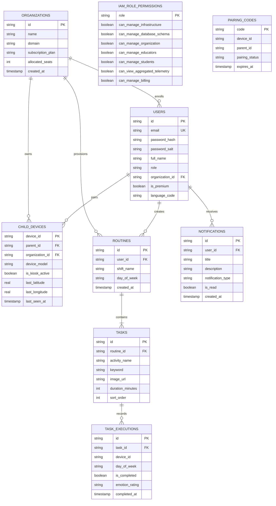

# U-Pad Cloud Platform Architecture & Database Documentation
**Target Cloud:** Google Cloud Platform (GCP)  
**Milestone:** 25% Deliverable  
**All Technical Identifiers & Documentation:** 100% English  

---

## 1. Editable Relational Database Diagram (Mermaid ER)



---

## 2. B2B IAM Role Hierarchy & Security Boundaries
*Principle of Least Privilege (PoLP)*

| Role | Scope | Cloud Infra Control | DB DDL / Alter Schema | School / Clinic Users | KMS Master Keys |
| :--- | :--- | :---: | :---: | :---: | :---: |
| **`DEVELOPER`** | Global Cloud Root | **YES (100%)** | **YES (100%)** | **YES** | **YES (Full Access)** |
| **`ORG_ADMIN`** | B2B School / Clinic | **NO (0%)** | **NO (0%)** | **YES (Tenant only)**| **NO (0%)** |
| **`EDUCATOR`** | Assigned Classroom | **NO (0%)** | **NO (0%)** | **Assigned students**| **NO (0%)** |
| **`PARENT`** | Household Unit | **NO (0%)** | **NO (0%)** | **Own child only** | **NO (0%)** |

> [!IMPORTANT]
> The **`ORG_ADMIN`** role is strictly bounded to the organizational tenant layer. It has **0% infrastructure permissions** in Google Cloud Console. Only the **`DEVELOPER`** role possesses 100% control over deployment pipelines, VPC, and Cloud KMS master keys.

---

## 3. Cryptography & Security Architecture

### A. Password Security Standard
1. **Validation Policy:**
   - Minimum length: 8 characters.
   - At least 1 uppercase letter (`[A-Z]`).
   - At least 1 numeric digit (`[0-9]`).
   - At least 1 special character (`[!@#$%^&*()_+\-=\[\]{};':"\\|,.<>\/?~]`).
   - Common sequences (e.g., `12345678`, `password`) are automatically blocked.
2. **Cryptographic One-Way Hashing:**
   - Symmetrical encryption is avoided for passwords because keys can be intercepted or decrypted.
   - Hashing is implemented with **PBKDF2** (Password-Based Key Derivation Function 2) using **100,000 SHA-512 iterations**.
   - Unique 16-byte random salt per user (`crypto.randomBytes(16)`).
   - Server-side **Pepper Key** protected by **Google Cloud KMS** & **Google Secret Manager**.

### B. Google Cloud Services Mapping (AWS vs GCP)

| Requirement | AWS Service | Google Cloud Platform (GCP) Equivalent | Purpose in U-Pad |
| :--- | :--- | :--- | :--- |
| **Monitoring & Alarms** | AWS CloudWatch | **Google Cloud Monitoring** | CPU, latency, socket metrics, uptime probes |
| **Centralized Logging** | CloudWatch Logs | **Google Cloud Logging** | Structured JSON logs with severity levels |
| **Key Management** | AWS KMS | **Google Cloud KMS** | Master encryption keys for pepper & credentials |
| **Secret Storage** | AWS Secrets Manager| **Google Secret Manager** | Secure storage for API secrets & environment tokens |
| **Data Analysis (Local)** | *N/A (Library)* | *Pandas (Python Library)* | *Note: Pandas is an in-memory data science library, NOT a cloud service.* |

---

## 4. Debouncing & Rate Limiting Protection

1. **Client-Side (Android Compose):**
   - Implemented via `rememberDebouncedClick` (`app/src/main/java/com/example/upad/utils/SecurityAndDebounceUtils.kt`) with a 900ms - 1200ms throttle.
   - Disables button interactions while `isLoading = true`.
   - ViewModel-level mutex gate in `RoutineViewModel.kt` `saveAll`.
2. **Server-Side (`cloud/server.js`):**
   - Action fingerprinting: If a user sends duplicate POST/PUT requests within 1200ms, the server drops the duplicate with `HTTP 429 Too Many Requests`.
   - Sliding window limiter: Maximum 120 requests per minute per IP.

---

## 5. Standardized HTTP Response Envelope

All API endpoints produce uniform JSON structures:
```json
{
  "status": "success",
  "statusCode": 200,
  "message": "Routine and tasks successfully synchronized.",
  "data": { ... },
  "error": null,
  "timestamp": 1792974433922
}
```

* **404 Route Not Found:** Returns standard JSON for REST clients and a styled HTML page for web browser requests.
* **501 Under Development:** Returns structured milestone notification for unreleased features targeted for the 80% deliverable.
